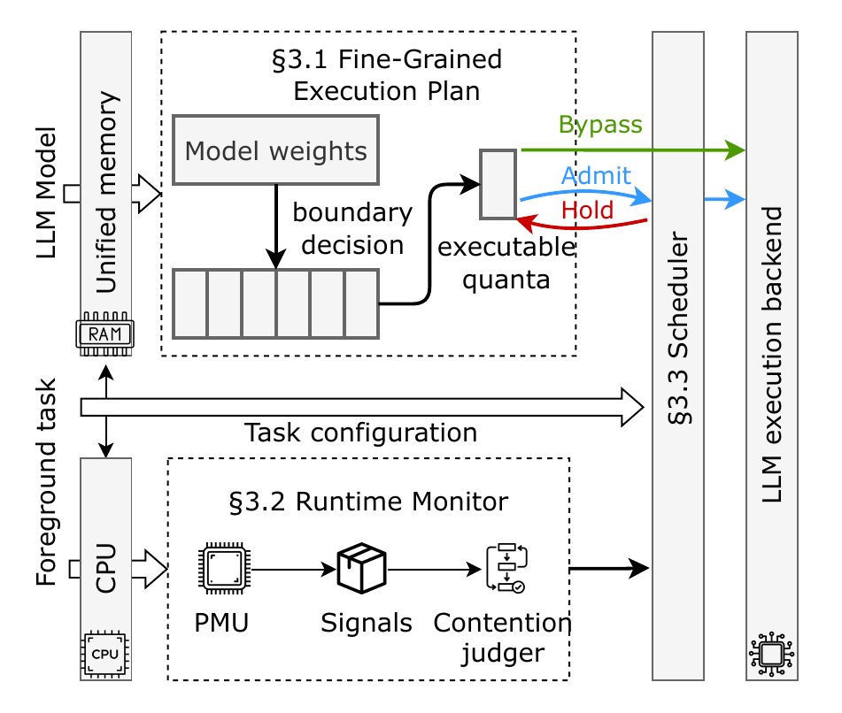

# EdgePace: Deadline- and Freshness-Aware LLM Scheduling on Unified-Memory Platforms

## What we set out to do

Run an LLM on an edge device, such as a Jetson board or a smartphone, alongside a
foreground application that processes sensor data in real time, and meet two goals
together:

- the application meets its deadlines;
- the LLM's answers arrive within their freshness window, while the observations they
  are based on are still useful.

## Why it is needed

On these devices the bottleneck is memory, not compute. The CPU, GPU and NPU share one
DRAM, and an LLM's model-weight transfers and KV-cache accesses take much of its
bandwidth. The application's memory requests are delayed, so it misses deadlines even
when compute is available.

The paper measures this with a four-camera application (33.3 ms deadline) on a Jetson
Orin Nano Super:

| Running beside the application | p95 latency | Deadline misses |
|---|---|---|
| nothing | 28.80 ms | 0.00 % |
| a compute-intensive GPU task | 28.92 ms | 1.11 % |
| a memory-intensive task | 43.90 ms | 72.78 % |

A real LLM does the same: in this repository's camera example, an unmanaged Qwen2.5-1.5B
raises misses from about 0.1 % to 12–14 %.

Regulating the LLM is not straightforward:

1. **Pausing.** The LLM needs safe, frequent pause points in both prefill and decode,
   without costly resumption.
2. **Sensing.** Aggregate bandwidth does not show when the application is being delayed,
   and better signals must not add interference of their own.
3. **Deciding.** Contention and deadlines keep changing, and the LLM must still finish
   before its input goes stale.

## What we built

EdgePace is a runtime built into llama.cpp, with one design piece for each problem. The
model does not change; the application only publishes its job timing (section 5).

<p align="center">
  
</p>

- **Fine Plan.** Cuts the LLM's graphs (prefill, decode, vision encoder) into quanta of a
  few milliseconds. The cuts fall only where execution can stop and resume without
  changing the result.
- **Runtime Monitor.** Reads PMU counters on the application's threads and derives the
  application's memory demand *D* and memory-stall share *S*.
- **Scheduler.** Combines *D*, *S* and the application's deadline slack into a risk ρ.
  Before each quantum it chooses one of three modes:
  - **Bypass** (low risk): run freely.
  - **Admit** (medium risk): one quantum at a time.
  - **Hold** (high risk): wait.

  A request close to its freshness deadline is admitted regardless of risk.

The weights and thresholds are not hand-tuned. A profiling run of a few minutes measures
them for each platform and application. [`docs/ARCHITECTURE.md`](docs/ARCHITECTURE.md)
gives the formulas and the code map.

## 1. Results

Deadline misses of the application, and the share of LLM throughput EdgePace keeps
compared with the unmanaged LLM. Each was measured from a fresh clone of this
repository.

| Workload | Platform | Unmanaged misses | EdgePace misses | Throughput kept |
|---|---|---|---|---|
| four 1080p cameras + Qwen2.5-1.5B | Jetson Orin Nano Super | 12–14 % | 2.7–3.4 % | 69–71 % |
| minimal application + Qwen2.5-1.5B | Jetson Orin Nano Super | ~6 % | 1.8–2.6 % | ~77 % |
| four 1080p cameras + Qwen2.5-1.5B (NPU) | OnePlus 13 | 9.7–10 % | 0.06–0.5 % | 85–86 % |

Section 4.3 covers the miss/throughput trade-off, run-to-run variance, and why the
numbers differ from the paper's.

## 2. Quick start

**Jetson Orin Nano Super** (JetPack 6 and `sudo`; about 40 min the first time):

```bash
git clone <this repository> edgepace && cd edgepace
scripts/setup_jetson.sh            # llama.cpp + EdgePace, build, model, test video, offline tests
tools/edgepace profile examples/workloads/light4cam_qwen25_1p5b_f16.toml      # ~5 min
tools/edgepace evaluate $(ls -d runs/profile_light4cam_qwen25_1p5b_f16_*/profile | tail -1)
```

**OnePlus 13** (rooted, with geniex-bench on the phone; the build host is x86_64 Linux or WSL):

```bash
export ANDROID_NDK_HOME=/path/to/android-ndk-r27c      # WSL: also export ADB=/mnt/c/.../adb.exe
android/setup_android.sh
tools/edgepace profile examples/workloads/oneplus13_phone4cam_qwen25_1p5b_f16.toml
tools/edgepace evaluate $(ls -d runs/profile_oneplus13_phone4cam_qwen25_1p5b_f16_*/profile | tail -1)
```

`evaluate` prints the unmanaged LLM's results next to EdgePace's. The rest of this file
covers four topics:
- [3. Deployment in detail](#3-deployment-in-detail)
- [4. Test cases](#4-test-cases)
- [5. Using EdgePace with your own application](#5-using-edgepace-with-your-own-application)
- the [repository layout](#repository), [troubleshooting](#troubleshooting) and the [license](#license)

---

## 3. Deployment in detail

### 3.1 Jetson

**Requirements**

| | |
|---|---|
| Board | Jetson Orin Nano Super, JetPack 6 (L4T R36, CUDA 12.6), power mode `MAXN_SUPER` available |
| Access | `sudo` (profiling and evaluation lock the CPU/GPU/EMC clocks, then restore the defaults) |
| Packages | `cmake` ≥ 3.18, `g++`, `make`, `git`, `curl`, `ffmpeg` with libx265, GStreamer with the NVIDIA plugins (`nvv4l2decoder`), `libopencv-dev` (OpenCV 4; only the example camera application uses it) |
| Python | ≥ 3.10; below 3.11: `python3 -m pip install -r requirements.txt` (tomli) |
| Disk | about 6 GB: llama.cpp CUDA build 1.1 GB, the example model 3.6 GB |

**Install (one command, ~40 min the first time)**

```bash
git clone <this repository> edgepace && cd edgepace
scripts/setup_jetson.sh
```

It runs the steps below. Re-running it skips the steps already done.

| Step | Script | Result |
|---|---|---|
| llama.cpp with EdgePace | `scripts/fetch_llama.sh` | `llama.cpp/`: upstream `790cf51` + `patches/llama.cpp/0001-edgepace.patch` (`LLAMA_REPO=` for a local mirror) |
| build | `scripts/build.sh` | `build/llama/bin/llama-server` (CUDA, ~25 min), `build/policy/libedgepace_policy.so`, `monitor/build/pmu_sampler`, `client/build/edgepace_client`, `build/foreground/fourcam_light`, `build/examples/minimal_app`, `build/stress/gpu_stress`; the CUDA architecture is this GPU's (`scripts/build.sh llama policy …` builds parts; `CUDA_HOME`, `CUDA_ARCH`, `JOBS`) |
| model | `scripts/fetch_models.sh qwen25-1.5b` | `models/qwen2.5-1.5b-instruct-fp16.gguf` (`--list` for the others; `MODELS_DIR=`) |
| test video | `scripts/make_test_video.sh` | `media/test_1080p30_hevc.mp4` (download, then ~14 min of x265 encoding on the CPU) |
| offline tests | `tests/run_offline.sh` | log in `build/offline_tests.log` |

**Profile, then measure**

```bash
tools/edgepace profile  examples/workloads/light4cam_qwen25_1p5b_f16.toml   # ~5 min, locked clocks
P=$(ls -d runs/profile_light4cam_qwen25_1p5b_f16_*/profile | tail -1)
tools/edgepace show     $P       # parameters and measurements (report.md)
tools/edgepace evaluate $P       # unmanaged vs EdgePace, 2 alternating rounds (~15 min)
```

`profile` writes a run directory `runs/profile_<name>_<time>/` containing:
- the Fine Plan (`plan/`);
- the measurement phases (`measure/`);
- the **profile directory** `profile/`, which holds `server.env` (the llama-server
  environment), `sampler.args`, `cut_plan.json`, `profile.json` (parameters, workload,
  platform and binary fingerprint) and `report.md`.

`--dry-run` only validates the workload and prints the steps.

**Run it (deployment)**

The LLM server and the application meet in a run directory of shared pages,
`/dev/shm/edgepace/<profile name>/`. Run in the platform state the profile was measured
in: power mode `MAXN_SUPER` with locked clocks. There are two ways to set that state:
- Lock the clocks by hand and restore them afterwards, as below.
- Wrap the commands in `scripts/locked_run.sh <dir> -- <command>`, which locks and
  restores both.

```bash
sudo nvpmodel -q                           # note the current power mode (the last line, e.g. 1)
sudo nvpmodel -m 2 && sudo jetson_clocks   # MAXN_SUPER (mode 2 on the Orin Nano Super), clocks locked

tools/edgepace check  $P                   # platform, binaries and model as profiled?
tools/edgepace serve  $P --port 8080       # terminal 1: llama-server with the EdgePace environment
tools/edgepace launch $P --frames 1800     # terminal 2: the PMU sampler launching the application
tools/edgepace request $P --body requests/text_4tok.json --count 30 --period-ms 1600 --print-reply
                                           # terminal 3: requests as a client would send them

# afterwards: the default clocks, then the power mode noted above
sudo jetson_clocks --restore platform/orin_nano_super_default.conf
sudo nvpmodel -m 1                         # the mode `nvpmodel -q` printed
```

To integrate EdgePace into your own launch scripts:
- `serve --dry-run` and `launch --dry-run` print the commands.
- `tools/edgepace env $P` prints the environment.

`serve --trace F` writes the policy's decision trace to the file `F`.

### 3.2 Phone (OnePlus 13 / Snapdragon 8 Elite)

**Requirements**

| | |
|---|---|
| Phone | Snapdragon 8 Elite (tested: OnePlus 13), rooted (`su` from adb shell), geniex-bench v0.3.14 unpacked on it (default `/data/local/tmp/geniex/geniex-bench-android-arm64-v0.3.14`) |
| Build host | x86_64 Linux (WSL works) with the Android NDK r27c (`ANDROID_NDK_HOME`), `cmake`, `ninja`, `git`, OpenCV 4 headers (`libopencv-dev` or `OPENCV_INCLUDE=`; the applications link the phone's own OpenCV 4.5.1, and headers 4.8 and 4.10 are tested against it), adb (from WSL: `export ADB=/mnt/c/.../adb.exe`) |
| Python | as on the Jetson |

**Install (one command, ~5 min plus downloads)**

```bash
export ANDROID_NDK_HOME=/path/to/android-ndk-r27c
android/setup_android.sh
```

| Step | Script | Result |
|---|---|---|
| llama.cpp with EdgePace | `scripts/fetch_llama.sh` | the shared headers and the policy source |
| phone base tree | `android/setup_base.sh` | upstream llama.cpp `be4a6a6` (the backend ABI of geniex's libraries), configured in `build/android-base/` |
| phone libraries | `android/pull_device_libs.sh` | from the phone: geniex's Hexagon and OpenCL backends, the phone's OpenCV, libc++, libbinder_ndk → `build/android-deps/` |
| build | `android/build_android.sh` | `build/android/{bin,lib}` (EdgePace `libggml-base.so`, llama-server, policy, sampler, client, applications), `SHA256SUMS` |
| model, video | `scripts/fetch_models.sh`, `scripts/make_test_video.sh` | as on the Jetson (no ffmpeg here: make the video elsewhere and put it in `media/`) |
| install | `android/install.sh` | everything in `/data/local/tmp/edgepace` (`DEVICE_ROOT=`), checked by sha256 |

**Profile, measure, run**

```bash
tools/edgepace profile  examples/workloads/oneplus13_phone4cam_qwen25_1p5b_f16.toml
P=$(ls -d runs/profile_oneplus13_phone4cam_qwen25_1p5b_f16_*/profile | tail -1)
tools/edgepace evaluate $P               # each phase locks the clocks itself, after the phone cooled down
tools/edgepace serve $P; tools/edgepace launch $P     # detached on the phone
tools/edgepace request $P --body requests/text_4tok.json --count 10 --period-ms 1600
tools/edgepace stop $P
```

`android/README.md` has the details:
- the differences between the phone and the Jetson;
- thermal capping;
- the phone's slow state, which the tools detect and work around.

---

## 4. Test cases

### 4.1 Offline tests (no GPU, phone or model)

```bash
tests/run_offline.sh
```

| Test | Checks |
|---|---|
| `tests/test_offline.py` | GGUF inspection and the model fingerprint; the Fine Plan from a profile trace (every legal boundary kept, vision quanta merged into 1–4 ms, a missing boundary is an error); the SLO check (one slow profile sample does not reject a plan; single-span quanta with `allow_uncuttable`); the interference factor k; the workload files and their `{repo}` placeholder |
| `monitor/tests/progress_predictor_test.cpp` | the sampler's progress predictor |
| builds | the sampler, the client and the policy library compile on the host |

### 4.2 Example workloads

Each file in `examples/workloads/` is a complete test case: one application, one LLM
load and one profile setting. To run one:
1. Profile it with `tools/edgepace profile <file>`.
2. Measure it with `tools/edgepace evaluate <profile dir>`.

Section 1 lists the expected results.

| Workload | Platform | Application | LLM load | Models (`fetch_models.sh`) |
|---|---|---|---|---|
| `light4cam_qwen25_1p5b_f16.toml` | Jetson | four 1080p30 camera streams (NVDEC decode, image processing) | Qwen2.5-1.5B F16, a 4-token request every 1.6 s | `qwen25-1.5b` |
| `minimal_app_qwen25_1p5b_f16.toml` | Jetson | `examples/minimal_app`: periodic memory-bound jobs (the template of section 5) | as above | `qwen25-1.5b` |
| `oneplus13_phone4cam_qwen25_1p5b_f16.toml` | phone | the paper's phone variant of the camera streams (MediaCodec, CPU cores) | Qwen2.5-1.5B F16 on the NPU, a 4-token request every 1.6 s | `qwen25-1.5b` |

### 4.3 Reading the results

**The warning horizon H.** H sets how early the scheduler reacts to shrinking slack,
trading LLM throughput for misses. The Jetson examples use H = 10. The table shows the
Orin Nano Super with the paper's parameters, three runs each:

| H (ms) | 8 | 10 | 12 | 16 |
|---|---|---|---|---|
| misses | 4.2 % | 3.7 % | 3.1 % | 1.6 % |
| throughput kept | 70 % | 70 % | 68 % | 65 % |

**Variance.** Runs differ by 1–3 points, for two reasons:
- The board's GPU leaves its locked clock under load (over-current throttling).
- The phone throttles thermally.

Use at least two rounds (`--repeats`). `docs/EVALUATION.md` explains the output table.

**Differences from the paper.** Absolute numbers differ from the paper's, for two
reasons:
- **Video.** The paper used its own camera clip, which is not public. The test video
  here (`make_test_video.sh`, cut from "Big Buck Bunny") is lighter work for the
  application.
- **Model.** The paper used Qwen2.5-1.5B-Instruct converted to F16 with llama.cpp's
  `convert_hf_to_gguf.py` (3.09 GB), not the official 3.56 GB file.

The reference profiles in `profiles/` are the ones measured for the paper, and their
`report.md` files show the measurements. They record paths as placeholders: `{repo}` is
this repository, `{models}` the model directory and `{external}` a tool built outside it.
Use them for reading and comparison only; `tools/edgepace profile` makes the profile you
deploy.

---

## 5. Using EdgePace with your own application

EdgePace needs three things from you:
- an application that publishes its job timing;
- an LLM client that marks its requests;
- a workload file.

`examples/minimal_app` and `examples/workloads/minimal_app_qwen25_1p5b_f16.toml` are a
complete, working template.

### 5.1 The application

Your application runs periodic **jobs** (frames), each with a release time and a
deadline. It must:

1. **Publish a task page.** Call `begin_frame` when a job starts and `complete` when it
   ends: `full_sched::task_snapshot_writer` in `foreground/light/include/full_sched/task_writer.h`.
   EdgePace reads the deadline and the remaining slack from it, and counts deadline
   misses.
2. **Publish a progress page.** Make three calls on
   `v3_progress::writer` in `monitor/third_party/v3_progress/foreground_progress.h`:
   - `begin` when the job starts;
   - `pipeline_started` when its memory-heavy stage starts;
   - `completed` when it ends.

   The sampler predicts the job's remaining work from it.
3. **Use CLOCK_MONOTONIC** for every timestamp (`std::chrono::steady_clock` on Linux).
4. **Take the page paths and a job count on its command line,** and exit after that
   many jobs.
5. **Be launched by the sampler.** `tools/edgepace launch` and the profile run your
   command under `pmu_sampler`, which counts the PMU events of all its threads.

The core of `examples/minimal_app/minimal_app.cpp`:

```cpp
#include "full_sched/task_writer.h"      // -I foreground/light/include
#include "foreground_progress.h"         // -I monitor/third_party/v3_progress

full_sched::task_snapshot_writer task(task_page, -1, period_ns, 1);
v3_progress::writer progress(progress_page);
for (uint64_t id = 1; id <= frames; ++id) {
    sleep_until(release);
    uint64_t start = now_ns(), deadline = release + deadline_ns;
    task.begin_frame(id, release, release, start, deadline, 0, 0, 0, 0);
    progress.begin(id, 0, release, start, deadline, release + period_ns, deadline + period_ns, 0);
    progress.pipeline_started(now_ns());
    run_job();                                            // your work
    uint64_t done = now_ns();
    task.complete(id, done, done > deadline, 0, 0, 0, 0, done, done);
    progress.completed(done);
    release += period_ns;
}
```

It builds with `scripts/build.sh minimal`, a single `g++` line with no other
dependencies. EdgePace itself does not use OpenCV or GStreamer; only the example camera
application does.

Run your application alone first; it prints its jobs' mean and maximum response time.
Size your job so it fits the deadline with room to spare: EdgePace protects slack, it
cannot create it.

### 5.2 The LLM client

Send requests to llama-server's OpenAI-compatible API as usual
(`POST /v1/chat/completions` on the `serve` port). While a request runs, mark it on the
**request page** (`<run dir>/request.page`). EdgePace only schedules while a request is
marked.

- C++: `client/edgepace_request_page.h`

  ```cpp
  edgepace::request_page page("/dev/shm/edgepace/my_app/request.page");
  page.publish(id, true, start_ns, start_ns + freshness_ns);   // the request starts
  /* ... HTTP request, wait for the answer ... */
  page.publish(id, false, start_ns, start_ns + freshness_ns, 1);   // it is done
  ```

- Python: `RequestPage` in `python/edgepace_phase.py` (same `publish` arguments).
- No code: `client/build/edgepace_client --port 8080 --body req.json --request-page <run dir>/request.page --period-ms 1600 --freshness-ms 1800 [--count N] [--csv out.csv]`,
  or `tools/edgepace request` as in section 3.1.

The freshness deadline is when the answer stops being useful. Once the remaining
service would no longer fit before it, EdgePace admits the LLM regardless of the
application.

### 5.3 The workload file

Copy `examples/workloads/minimal_app_qwen25_1p5b_f16.toml` (or run `tools/edgepace init`)
and set:

```toml
name = "my_app"
[foreground]
command = "/path/to/my_app --frames {frames} --task-page {task_page} --progress-page {progress_page}"
period_ms = 33.333        # job period
deadline_ms = 33.333      # relative deadline
[llm]
model = "/path/to/model.gguf"
request = "/path/to/one_request.json"     # a body exactly like your client's
period_ms = 1600          # how often your client sends (0 = back to back)
max_tokens = 4
freshness_ms = 1800
[profile]
mode = "quick"
horizon_ms = 10           # throughput first; larger = fewer misses
```

`{frames}`, `{task_page}` and `{progress_page}` are filled in per run, and `{phase_dir}`
gives you a per-run output directory. For a VLM, set `llm.mmproj` and use an image
request (`requests/vlm_image_16tok.json`). `docs/WORKLOAD.md` lists every key.

### 5.4 Profile, check, tune

```bash
tools/edgepace profile  my_app.toml
tools/edgepace evaluate runs/profile_my_app_*/profile --repeats 2
```

Read `report.md` in the profile directory:

| Line | Meaning |
|---|---|
| Foreground alone: misses, response p95 | your application without the LLM; misses here are not EdgePace's to fix |
| beside the unmanaged LLM: misses | what EdgePace should bring down |
| stall AUC → wS | whether the PMU stall share sees the LLM's contention (wS 0.7) or not (wS 0) |
| interference k | how much longer your jobs take while the LLM runs |
| Thresholds, Parameters | what `serve` will use |

| If you see | Try |
|---|---|
| too many misses with EdgePace | a larger `horizon_ms` (12, 16, 20); `interference = true` |
| too little LLM throughput | a smaller `horizon_ms` (down to ~8) |
| unsure which H | `mode = "sweep"` with `horizons = [8, 10, 12, 16]` and `objective = "miss"`, `min_retention = 0.68` (or `objective = "throughput"`, `miss_budget = 0.03`) |
| the Fine Plan is rejected: a body quantum exceeds the reference | `prefill_boundaries = ["ffn_inp", "ffn_gate", "ffn_up", "l_out"]` or a smaller `ubatch_size` (long prompts) |
| rejected: a single-span quantum (LM head, patch embedding) exceeds it | `allow_uncuttable = true` if the accelerator cannot run that operation |
| misses alone already | the job does not fit its deadline: make it lighter or the deadline longer |

### 5.5 Other platforms

- **Other Jetsons.**
  - The build detects the GPU's CUDA architecture. `CUDA_ARCH=` overrides it; 87
    (Orin) is the fallback when the GPU cannot be queried.
  - `scripts/locked_run.sh` is set for the Orin Nano Super. For your board, set
    `MAXN_MODE` and `DEFAULT_MODE` (nvpmodel modes) and `EXPECT_EMC_HZ`.
  - Store your board's default clocks with `sudo jetson_clocks --store my_board.conf`
    and point `platform.default_conf` at that file.
- **PMU events.** By default the sampler counts `stall_backend_mem` and
  `ll_cache_miss_rd` (Cortex-A78). Choose others with `--stall-event` and `--llc-event`.
  The phone does this (`stall`, `l2d_cache_lmiss_rd`); see `python/edgepace_android.py`.
- **Other phones.** `android/locked_run_android.sh` locks the OnePlus 13's clocks, and
  the Hexagon v79 backend matches the Snapdragon 8 Elite.
- **Models.** Dense decoder-only models and Qwen2/2.5/3-VL are supported. The Fine Plan
  rejects mixture-of-experts models.

---

## Repository

| Path | Content |
|---|---|
| `patches/llama.cpp/` | EdgePace's changes to upstream llama.cpp, applied by `scripts/fetch_llama.sh`: the scheduler (`ggml/src/ggml-backend.cpp`, `ggml-edgepace.h`, `edgepace/abi.h`) and the policy library (`external/edgepace_policy/`) |
| `python/` | Host tools: Fine Plan (`edgepace_fineplan.py` planner, `edgepace_plan.py` profiling and cache), parameter profile (`edgepace_profile.py`), workload files (`edgepace_workload.py`), measurement phases (`edgepace_phase.py`), evaluation (`edgepace_eval.py`), command line (`edgepace_cli.py`), phone driver (`edgepace_android.py`) |
| `tools/edgepace` | The command line: `init`, `profile`, `show`, `evaluate`, `check`, `env`, `serve`, `launch`, `request`, `stop`, `plans` |
| `requests/` | Example request bodies (`text_4tok.json`, …, `vlm_image_16tok.json`, …) |
| `monitor/` | `pmu_sampler`: launches the application with per-thread PMU counters and publishes D and S on the signal page |
| `client/` | `edgepace_client` and `edgepace_request_page.h` |
| `foreground/` | The camera applications: `light/fourcam_light.cpp` (Jetson NVDEC; also built for Android), `android/fourcam_phone.cpp` (the paper's phone variant). Per frame: OpenCV converts the decoded NV12 to RGBA, hand-written NEON stages denoise, enhance and composite, OpenCV converts back to YUV (`cv::setNumThreads(1)`: one pinned worker per camera) |
| `examples/` | `minimal_app/` (the application template) and `workloads/` (the test cases) |
| `android/` | The phone port: scheduler overlay for geniex's llama.cpp (`llama-overlay/`), backend shims, setup, build, install, clock lock (`android/README.md`) |
| `scripts/` | `setup_jetson.sh`, `fetch_llama.sh`, `build.sh`, `fetch_models.sh`, `make_test_video.sh`, `locked_run.sh` |
| `stress/` | GPU memory stressor (`mode = "sweep"` only) |
| `profiles/` | Reference profile directories measured for the paper |
| `tests/` | Offline tests |
| `docs/` | `ARCHITECTURE.md` (mechanism, formulas, code map), `WORKLOAD.md`, `EVALUATION.md`, `figures/` |

The example models come from Hugging Face. The test video is cut from "Big Buck Bunny"
(© Blender Foundation, www.bigbuckbunny.org, CC BY 3.0). `make_test_video.sh
--synthetic` makes an offline test pattern instead.

## Troubleshooting

- **The profile refuses to run.** The platform is not in `MAXN_SUPER` with locked
  clocks. Run the profile through `tools/edgepace profile`, which locks the clocks, or
  through `scripts/locked_run.sh`.
- **The sampler reports no valid windows.** The PMU counters need
  `sudo sysctl kernel.perf_event_paranoid=1` or lower.
- **`LOCK_CONTINUOUS=0` in a lock log.** A clock left its lock during the run: GPU
  over-current throttling on the Orin Nano Super, or thermal capping on the phone. The
  results stay usable but vary more; repeat the measurement.
- **`fetch_models.sh`: not enough free space.** Free some disk space, or set `MODELS_DIR`
  to another location and point `llm.model` there.
- **Phone measurements** have their own pitfalls; see `android/README.md`.

## License

MIT (`LICENSE`). The llama.cpp patch modifies llama.cpp, which is itself MIT-licensed.
llama.cpp, geniex-bench, the models and the test video are fetched from their own
sources under their own licenses, and are not part of this repository.
